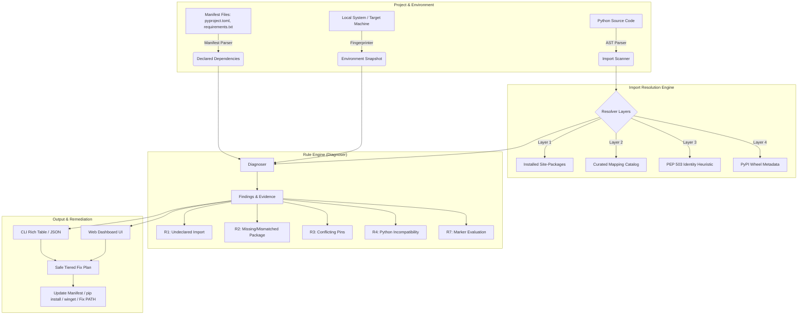

# Parity

<p align="center">
  <strong><em>"Make every machine match."</em></strong>
</p>

<p align="center">
  A developer tool and diagnostic engine that explains why a Python project works on one machine but fails on another, proposes safe fixes, and applies them deterministically.
</p>

<p align="center">
  
  
  
  
</p>

---

## Table of Contents

- [Overview](#overview)
- [Key Features](#key-features)
- [How It Works](#how-it-works)
- [Diagnostic Rules Catalog](#diagnostic-rules-catalog)
- [Installation](#installation)
- [Quick Start](#quick-start)
- [CLI Reference](#cli-reference)
  - [`scan`](#1-parity-scan)
  - [`fingerprint`](#2-parity-fingerprint)
  - [`diagnose`](#3-parity-diagnose)
  - [`resolve`](#4-parity-resolve)
  - [`update-mapping`](#5-parity-update-mapping)
- [Web Dashboard](#web-dashboard)
- [Security & Threat Model](#security--threat-model)
- [Development & Testing](#development--testing)
- [Project Structure](#project-structure)
- [License](#license)

---

## Overview

The classic *"works on my machine"* problem is often caused by subtle, overlooked environment mismatches:

- **Undeclared Imports:** Dependencies imported in Python code that work locally because they happen to be installed in the developer's virtualenv, but are omitted from `requirements.txt` or `pyproject.toml`.
- **Version Drift & Conflicting Pins:** Dependencies with loose or disjoint version constraints that resolve differently across machines.
- **Platform Markers (PEP 508):** Conditional dependencies (e.g. `pywin32` on Windows, `uvloop` on Linux) behaving unexpectedly when projects are shared across OSes.
- **Native Tool Dependencies:** C/C++ compilers (`cl.exe`, `gcc`), build tools (`cmake`, `make`), and external binaries (`git`, `ffmpeg`, `docker`) missing or not present on `PATH`.
- **Python Runtime Incompatibilities:** Minor version mismatches (e.g. 3.11 vs 3.12 syntax or library differences).

**Parity** eliminates the guesswork by combining **AST-based static import analysis**, **manifest extraction**, **deep environment fingerprinting**, and a **rule-based diagnostic engine** to detect discrepancies, provide clear explanations with confidence scores, and automate safe fixes.

---

## Key Features

- 🔍 **Static AST Import Scanning**: Safely inspects Python source files using Python's native AST parser without executing any project code. Separates imports into **Runtime**, **Dev/Test**, and **Optional** (e.g., inside `try/except ImportError` blocks).
- 📦 **Multi-Format Manifest Parser**: Extracts declared dependencies from `pyproject.toml` (PEP 621, Poetry, Flit), `requirements.txt`, `setup.py` (AST-analyzed without execution), and `Pipfile`.
- 🖥️ **Deep Environment Fingerprinting**: Deterministically captures the Python version, executable path, virtualenv status, exact installed distribution versions, platform architecture tags, and native system tools. Fingerprints can be saved as shareable, redacted JSON snapshots (`env.json`).
- 🧠 **Multi-Layer Package Resolver**: Accurately maps Python import module names to their PyPI distribution packages (e.g., `cv2` → `opencv-python`, `yaml` → `PyYAML`, `PIL` → `Pillow`, `dateutil` → `python-dateutil`) across four resolution layers.
- ⚖️ **Confidence-Scored Diagnostic Rules**: Categorizes findings by severity (`HIGH`, `MEDIUM`, `LOW`) and confidence (`High`, `Medium`, `Low`), providing exact file and line references for every issue.
- 🛠️ **Remediation & Auto-Fixing**: Provides structured fix actions—such as adding missing packages to manifests, running safe `pip install` commands, installing missing native tools via `winget`, or repairing system `PATH`.
- 📊 **Interactive Web Dashboard**: Includes a modern dark-mode GUI dashboard (`http://localhost:5117`) for visual project health inspection, dependency exploration, manual package resolution, and one-click fixes.
- 🛡️ **Zero-Execution Security Model**: Protects against malicious virtual environments, avoids executing untrusted `.pth` files via `-S -I` flags, and sanitizes working directories during tool probing to prevent CWE-426 binary planting attacks.

---

## How It Works



---

## Diagnostic Rules Catalog

Parity evaluates projects against a curated rules catalog:

| Rule ID | Name | Default Severity | Description | Fix Action |
|:---:|:---|:---:|:---|:---|
| **R1** | **Undeclared Import** | `HIGH` / `LOW` | An imported module is not declared in any dependency manifest (`pyproject.toml`, `requirements.txt`). Optional imports default to low confidence. | Adds package to manifest or installs via pip. |
| **R2** | **Missing or Mismatched Dependency** | `HIGH` | A declared package is either completely missing from the target environment or does not satisfy specified version constraints. | Installs/upgrades distribution to match specifier. |
| **R3** | **Conflicting Pins** | `MEDIUM` | Multiple conflicting pins exist across project manifests (e.g. `==1.0` and `==2.0`). | Manual review required to unify pinned versions. |
| **R4** | **Python Incompatibility** | `HIGH` | The target Python runtime does not satisfy the project's `requires-python` constraint. | Switch or install compatible Python interpreter. |
| **R7** | **Marker Evaluation** | `LOW` | Evaluates PEP 508 environment markers (e.g. `sys_platform`, `python_version`) against the target environment. | Informs whether platform-specific packages apply. |

---

## Installation

### Prerequisites

- Python 3.11 or newer

### Setup

```bash
# Clone the repository
git clone https://github.com/Rajat-Solankii/Parity.git
cd Parity

# Create and activate a virtual environment
python -m venv .venv

# Windows (Command Prompt or PowerShell)
.venv\Scripts\activate

# Linux / macOS
source .venv/bin/activate

# Install Parity in editable mode
pip install -e .

# (Optional) Install development and testing dependencies
pip install -e ".[dev]"
```

---

## Quick Start

### 1. Diagnose Your Project

Run diagnosis on the current directory:

```bash
parity diagnose .
```

To diagnose against a remote or baseline machine's environment snapshot:

```bash
parity diagnose . --against env.json
```

### 2. Capture an Environment Fingerprint

Generate a deterministic snapshot of your active environment:

```bash
parity fingerprint --out env.json --redact
```

### 3. Launch the Web Dashboard

Start the interactive web dashboard:

```bash
python frontend/server.py
```

Then open **`http://localhost:5117`** in your browser.

---

## CLI Reference

Parity exposes a comprehensive CLI powered by `rich`:

```bash
parity --help
```

### 1. `parity scan`

Scans project files for declared dependencies and actual AST imports.

```bash
# Scan a single project
parity scan ./my-project

# Recursively scan all sub-projects
parity scan ./workspace --all

# Scan with an explicit manifest override
parity scan ./my-project --manifest ./my-project/custom-reqs.txt
```

### 2. `parity fingerprint`

Captures the current system and Python environment profile into a standardized JSON format.

```bash
# Basic fingerprint
parity fingerprint --out env.json

# Check specific Python binary and custom native tools
parity fingerprint --python /usr/bin/python3.11 --tool rustc --tool ninja --out env.json

# Redact user names and sensitive local paths
parity fingerprint --redact --out env.json
```

### 3. `parity diagnose`

Evaluates diagnostic rules against the current environment or a saved fingerprint.

```bash
# Diagnose local directory in formatted terminal tables
parity diagnose .

# Compare project against another machine's environment snapshot
parity diagnose . --against env.json

# Output as machine-readable JSON (ideal for CI/CD pipelines)
parity diagnose . --format json
```

### 4. `parity resolve`

Tests how Parity maps a module import name to its corresponding PyPI distribution.

```bash
# Quick lookup
parity resolve cv2

# Detailed layer explanation
parity resolve cv2 --explain
```

### 5. `parity update-mapping`

Regenerates and refreshes the bundled import-to-distribution mapping database.

```bash
parity update-mapping
parity update-mapping --online
```

---

## Web Dashboard

Parity includes a lightweight web dashboard served via Flask:

```bash
python frontend/server.py
```

### Dashboard Features

1. **Overview & Health Metrics:** Instant summary cards displaying count of findings, declared dependencies, and imported modules.
2. **Interactive Findings Explorer:** Review diagnostic findings filtered by severity (`HIGH`, `MEDIUM`, `LOW`) with expandable code evidence and fix actions.
3. **1-Click Auto Solve:** Automatically append undeclared packages to `requirements.txt` or install missing dependencies directly from the interface.
4. **Environment & Native Tools Inspector:** Inspect installed packages, check native tools (`git`, `cmake`, `docker`, `ffmpeg`, `gcc`, `make`), install missing tools via `winget`, and fix missing `PATH` entries with a single click.
5. **Interactive Import Resolver:** Test and debug import names with live candidate suggestions and layer confidence indications.
6. **Raw JSON Inspector:** Full visibility into the complete diagnostic payload and environment snapshot.

---

## Security & Threat Model

Parity is designed with strong defense-in-depth principles when analyzing potentially untrusted codebases:

1. **Target Environment Isolation:** Parity never blindly executes scripts within untrusted target environments. It uses static `pyvenv.cfg` parsing as the primary method to discover `site-packages`. When invoking the interpreter for configuration queries, it forces `-S -I` flags to neutralize `.pth` script injection attacks.
2. **Safe Tool Probing:** Discovery of native tools avoids arbitrary code execution. Probing uses explicit timeouts, `shell=False`, neutral working directories (`tempfile.TemporaryDirectory()`), and sanitized `PATH` lookups to prevent local directory binary planting (CWE-426).
3. **Data-Only `.pth` Parsing:** Editable install discovery parses `.pth` files strictly as plain text, explicitly ignoring lines containing executable `import ` statements.
4. **Online Hash Verification:** When resolving packages online, Parity verifies wheel SHA-256 digests from `files.pythonhosted.org` and enforces bounded reads to prevent zip-bomb / denial-of-service attacks.

For more details, see [docs/threat_model.md](file:///d:/Desktop/Parity/docs/threat_model.md).

---

## Development & Testing

Parity includes an extensive test suite featuring unit tests, determinism checks, and a broken/healthy evaluation corpus.

### Running Tests

```bash
# Run test suite
pytest

# Run with verbose output
pytest -v
```

### Linting & Formatting

```bash
# Run Ruff linting
ruff check parity tests

# Run Mypy static type checking
mypy parity
```

---

## Project Structure

```
Parity/
├── parity/                     # Core Parity Python Package
│   ├── cli.py                  # CLI entrypoint & commands
│   ├── data/                   # Bundled mappings and tool catalogs
│   │   ├── import_mapping.json # Curated import-to-distribution mappings
│   │   └── tool_catalog.json   # Native tool detection definitions
│   ├── diagnose/               # Diagnostic engine & rule implementations
│   │   ├── engine.py           # Evaluator for rules R1, R2, R3, R4, R7
│   │   ├── models.py           # Finding, FixAction, Severity, Confidence
│   │   └── rules_catalog.json  # Rule catalog & explanation templates
│   ├── env/                    # Environment capture & fingerprinting
│   │   └── fingerprint.py      # OS, Python, package, and tool detection
│   ├── resolve/                # Multi-layer import-to-package resolver
│   │   └── mapping.py          # Resolution layers (1-4)
│   └── scan/                   # Static analysis
│       ├── ast_import.py       # Safe AST import parser (Runtime/Dev/Optional)
│       └── manifest.py         # Multi-format manifest parser
├── frontend/                   # Web Dashboard
│   ├── index.html              # Dashboard markup
│   ├── index.css               # Styling
│   ├── app.js                  # Frontend client application logic
│   └── server.py               # Local Flask API server
├── docs/                       # Documentation
│   └── threat_model.md         # Threat model & security mitigations
├── tests/                      # Test suite & evaluation corpus
│   ├── corpus/                 # Healthy and broken fixture projects
│   ├── test_determinism.py     # Determinism & idempotency tests
│   ├── test_diagnose.py        # Rule engine corpus evaluation
│   ├── test_env.py             # Fingerprinting and security tests
│   ├── test_resolve.py         # Import resolution tests
│   └── test_scan.py            # AST & manifest scan tests
├── tools/                      # Build & maintenance scripts
│   └── build_mapping.py        # Import mapping generator
├── pyproject.toml              # Project configuration & dependencies
└── README.md                   # Project documentation
```

---

## License

This project is licensed under the terms specified in the repository.
